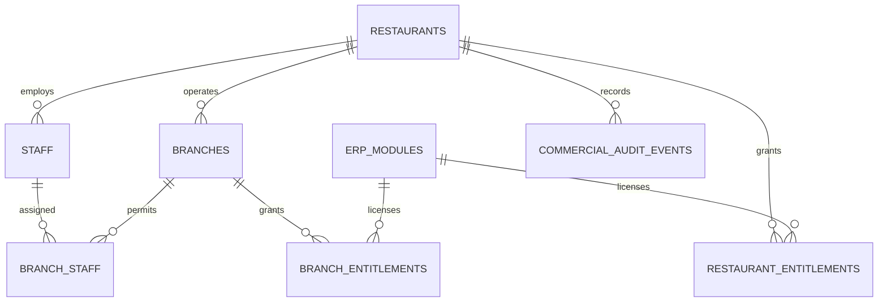
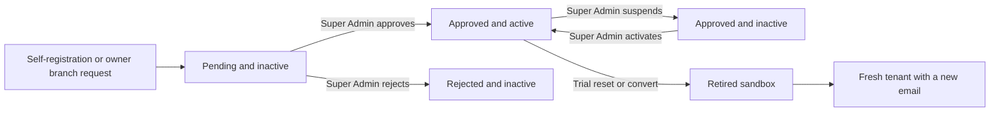
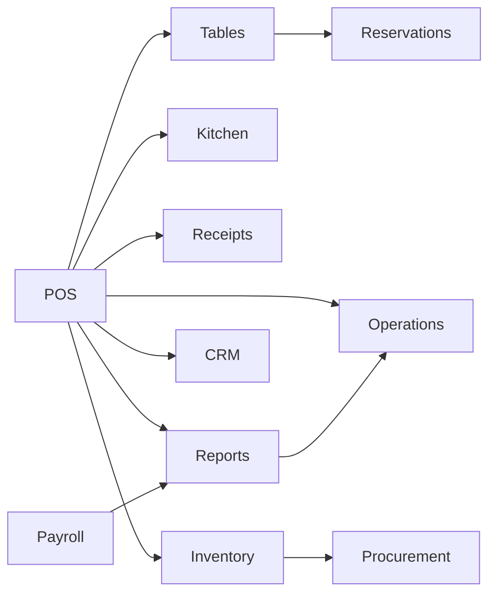

# Phase 0.5 commercial foundation

## Schema

The additive migration preserves existing restaurant and branch approval and activity flags. Existing staff retain their branch assignments and receive cashier as the least-privilege default. No production tenant receives automatic licenses. A branch entitlement references the composite restaurant and branch key. Audit rows record actor type and ID, target IDs, timestamp, event and bounded event metadata. IDs are retained independently of entity deletion. Passwords never enter audit metadata.

Future order lines, payment attempts, visits, table QR requests, stock movements, and branch cash and expenses carry verified restaurant and branch ownership. Restaurant-scoped CRM, products and employee records require scoped relationships. Reporting jobs and exports re-check permission and ownership. Use decimal money, composite ownership constraints and indexed idempotency/state keys before enabling those modules.

## Approval and lifecycle

Public registration creates a pending tenant and password-hashed owner in one transaction. Super Admins verify the business and applicant outside the application before approval. Rejected registrations remain on record and require administrator follow-up for reuse of the address. The direct central create form is an explicit approval by the Super Admin, retained for Phase 0 compatibility. An existing owner can request a branch without any current branch assignment, and the new branch assignment becomes usable only after approval. Approval, activation, expiry, entitlement and role changes record audited state transitions. Activating a pending, rejected or retired record is denied.

## Permission and module policy

All roles require an active approved tenant whose commercial term is still valid, plus an active account. Branch operations additionally require an active approved branch and explicit membership. Licensing requires a platform-enabled registered module and an explicit enabled tenant grant. Branch work also requires an explicit branch grant. Unknown module codes and roles have no access. Role and license gates run on the server; the module availability page exercises both route enforcement and menu filtering. Future modules call the same service and add action-specific authorization. Tenant-wide owner reporting will aggregate only authorized branch data. The separate Super Admin session never grants a staff session or transactional rights by itself.

| Role | Phase 0.5 authority | Future module areas, subject to license and action policy |
| --- | --- | --- |
| Super Admin | Approvals, registry switches, grants, account roles/status, trials, renewal, audit review | Platform control |
| Owner | Request branches, assigned workspace | All operational modules and authorized consolidated views |
| Manager | Assigned workspace | Operations, reporting, approved HR responsibilities |
| Cashier | Assigned workspace | POS, tables, receipts, CRM, reservations |
| Chef/Kitchen | Assigned workspace | KDS and recipes with no financial/HR access |
| Waiter/Floor | Assigned workspace | Assigned table/order and reservation operations, no settlement authority by role alone |
| Procurement | Assigned workspace | Inventory and procurement |
| HR | Assigned workspace | HR and payroll |

Registry codes are versioned with the implementation. Super Admin can independently disable any code globally or at either tenant level. The dependency graph describes build and integration order. Granting a dependent module does not implicitly grant its prerequisites.

## Demo and trial isolation

A public demo creates a unique one-hour sample restaurant, cashier and branch for the browser session. Its credentials are generated server-side and never exposed, and ordinary staff sign-in excludes demo tenants. Public provisioning is throttled. Reset retires the current sample and opens a fresh one. Trials use independent credentials, selected grants, sample branch and configurable expiry. Reset creates a fresh trial with new credentials and email. Conversion explicitly opens an empty production restaurant with new credentials and email, retires the trial, and transfers no grants, branches or business records. The previous tenant remains available for central audit. Configure retention and deletion policy before public rollout.

The access expiry is checked on login and every protected request. Super Admin can renew it manually. Any future external payment, order, messaging or vendor action must additionally call the production-only gate before side effects. Sandbox identifiers must remain excluded from production aggregation and exports. Phase 0.5 contains a sample workspace and module-access screens; transactional sample data arrives with operational modules.

## Configuration and validation

No extra environment credentials or dependencies are required for the migration. Run `php artisan migrate` before startup with the existing database and lockfile. Use `composer test` and `vendor/bin/pint --test`. Never run test migrations against a development or production schema. Hosting and provider selection remain deferred.
