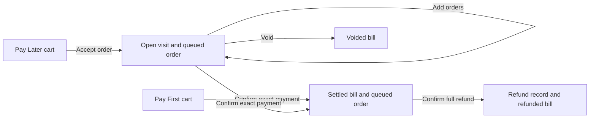

# Phase 1 core POS

## Try the counter

1. In central administration, approve the restaurant and branch, grant POS at both levels, and assign an owner or manager and cashier to the branch.
2. Sign in as staff and open the branch and select **POS and billing**.
3. Open **Menu and settings**. Create a restaurant category and product. The product is available at the creating branch. Enable it separately at other assigned branches and set an optional branch price.
4. As owner, select **Pay First** or **Pay Later** and enable the branch payment methods. Existing branches start with Pay First and Cash.
5. In **New sale**, search or filter the menu, add products, enter quantities and notes, and review the total. F2 focuses search and Enter from search focuses the first result. You can open New Sale in separate tabs and work on independent carts.
6. In Pay First, verify receipt of the payment, select a method and optional collection token, then confirm. For non-cash methods, enter the external transaction reference. In Pay Later, create an unpaid visit. Use **Open visits** to add separate orders and settle the complete bill once.
7. Use **Bill history** to review the recorded payment, line snapshots, and status. Owners and managers can cancel an unpaid order, void an unpaid bill, or record a full confirmed refund. These actions require a reason.

Public demos and POS-enabled trials created with Phase 1 include a sample menu. Reset an existing demo to load the sample products. Financial records carry a simulation marker for demo and trial tenants, and no operation calls a payment gateway.

## Permissions and ownership

POS requires the commercial approval, account, expiry, branch membership, and restaurant and branch grant gates. Only owners, managers, and cashiers operate the counter. Owners and managers can create catalog records and control stock-independent availability and branch pricing within their licensed assignments, enter discounts and charges, and make audited adjustments. Only owners can edit existing restaurant-wide category and product definitions or change branch billing settings. Waiter workflows are scheduled for Phase 2.

Menu categories and products have restaurant keys. Branch prices and availability reference both their branch and the restaurant's product. Bills represent one Pay First transaction or an open Pay Later visit. Orders and payments reference a bill through composite ownership keys. Order lines keep the accepted product name, price, quantity and note independent of later menu changes. Collection tokens may repeat and do not identify the order. Every order has a unique identifier.

## Transactions and reconciliation

Browser carts live in memory in each tab. The server reads and verifies branch prices against the displayed prices and calculates the total. The browser keeps the in-flight request key and its exact payload only in memory. On an unknown result, use **Check server status** or **Retry same request** before resubmitting. If the tab is closed first, reconcile against **Bill history** before starting a replacement transaction. The server binds a key to its staff actor and payload. Eligibility checks, the branch write lock, bill state transitions, unique payment-per-kind constraints and idempotency records isolate concurrent changes. SQLite uses an immediate write transaction. MySQL and MariaDB use a branch row lock. Status also scopes lookup to the recorded actor.

Money is stored in integer minor units and accepted as decimal strings with at most two decimal places. Subtotal is the sum of unit price times quantity. Subtract the recorded discount and add explicit VAT, SD and service-charge amounts. No automatic rate or rounding formula is assumed. The displayed total must match the server total. Pay Later is recognized once at successful full settlement. Accepted orders remain individually distinct and kitchen-eligible before settlement. A paid bill and queued order are committed together in Pay First. A mode change requires all open visits to be settled or voided.

For future reporting, count confirmed payment entries at settlement, subtract confirmed refund entries separately, and filter simulated bills out of production totals. Preserve original settled time and amount even after refund. Unpaid or voided bills produce no payments. Operational P&L is confirmed sales including VAT, SD and service charge minus recorded expenses. No automatic COGS or tax expense deduction applies. Reporting, expenses, and financial exports are deferred.

## Decisions before expansion

Confirm tax rates, applicable bases, legal rounding and receipt requirements. Decide partial or split tender, overpayment and change, partial refunds, refund timing, reference uniqueness by provider, and any additional approval thresholds. This phase supports one exact settlement and one optional full refund, entered by authorized staff. Method references provide an audit trail and do not perform external verification.

Table assignment, guest QR, waiter workflows, KDS screens, delivery, thermal printing and sales analytics remain staged for later phases. The current counter does not change the existing post-login workspace. The sales dashboard remains the planned default in Phase 4. Development and deployment remain portable with no gateway or hosting assumptions.
